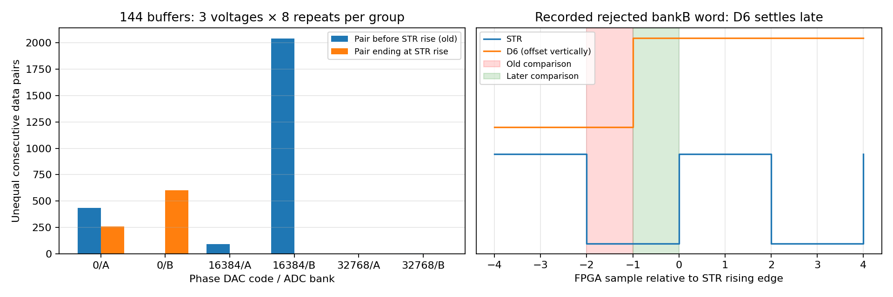

# ADC2 timing diagnostic — 18 November2026

DUT PM12-K7-3A17A1B402212223, MCU1803, FPGAff2f746c. ADC channel2 remains INCOMPLETE in production campaign. No gateware/MCU/CPLD programming or PLL profile change; no original decoder or qualification criteria modified.

Original three rejected buffers show isolated D2/D6 settling one FPGA sample later than the old two-samples-before-STR condition expects. At those exact events the pair ending at STR rise agrees. The capture implementation uses MultiReg on the14-bit raw bus; CPLD mux source forwards selected ADC and CLK80 as DV. Source copies are contextual evidence, not a new resident-build equivalence proof.

Fresh144buffers: phase codes0/16384/32768, both banks, differential inputs−0.234375/+0.046875/+0.3375V,8repeats each. Every raw buffer retained; all five temporal windows compared. Original decoder failures were counted, never suppressed or marked PASS. Analysis source frozen before acquisition.

| Phase | Bank | Unequal old pairs(-2,-1) | Unequal later pairs(-1,0) |
|---|---|---:|---:|
|0|A|434|257|
|0|B|0|604|
|16384|A|90|0|
|16384|B|2042|0|
|32768|A|0|0|
|32768|B|5|0|

For phases16384/32768 the later pair has0disagreements over98112checked pairs,96buffers. Phase0 is not a common valid sampling window. These observations favor phase-dependent sampling/window selection over a persistent stuck/shorted data line. They do not certify physical setup/hold margins, identify a faulty device, or establish full-range ADC qualification. An alternative decode policy needs explicit timing validation and a separate protocol version before use in production acceptance; simply ignoring early mismatches is insufficient.

Acquisition completed144buffers before a redundant inhibit callback erroneously ran after its I2C route had closed (NACK). Routed inhibit had already completed. Independent final cleanup returned0 and verified phase0, DAC01=1/1V,23=1.024/2.048V, fitted1–4 amps/bypass/monitor inhibition and TCA0. Shared Kasli outputs unchanged. The acquisition wrapper exits nonzero for that cleanup-callback error; it is recorded rather than hidden. Current script is the exact executed source.

Raw archive includes144newbuffers, original3failed buffers, logs and source snapshots. All files read-back SHA256 verified. No PDF production report generated.

