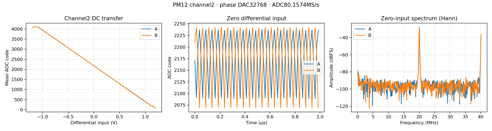

# ADC2 window correction — 18 November2026

Board PM12-K7-3A17A1B402212223, MCU1803, FPGAff2f746c, CFD03 on PM2. Full ADC A/B transfer and sampled12-bit/11-adjacent-pair tests PASS with explicit str-rise window at phaseDAC32768. Independent reconstruction validates514buffers/2105344raw words, exact histograms/tags, contiguous generations, STR period4 throughout and no selected-word disagreement. Acquisition also retains the final zero control.

The corrected decoder compares data at observed STR rise to the preceding sample. Both must agree; wrong size/tags/reserved bits, missing/extra STR edges, excessive drift, pulse widths and any data disagreement remain errors. Legacy before-str remains the default for existing callers. New acquisition records sample_window; validators and ADC receipt FFT/time extraction use that same policy. Receipts carry a separate v2 method, never silently reinterpreting older data. No retries or data deletion within the successful scan.

An earlier corrected-window attempt at phase16384 stopped after74buffers with12unstable positions; it is retained unchanged. Three-point calibration did not cover its entire voltage range. This result supports32768 for this channel/setup, not universal phase suitability. Old phase0/16384/32768 failures and144buffer diagnostic remain in their respective evidence folders.

Software tests:13decoder tests (including all3real rejected buffers and a deliberately unstable later sample) plus26campaign tests PASS in the appropriate environments. Initial campaign test invocation with system Python lacked plotting dependencies; the scientific venv run passed.

The attempted separate campaign was prepared after acquisition and correctly rejected the older identity receipt. No identity timestamps or campaign guards were modified. New-method receipts are raw-validated using the already-bound original fitting context, retained here but unselected in the old frozen campaign. A future v2 campaign must bind identity before its acquisitions. Failed registration logs remain archived; no old production selection changed.

No CPLD/FPGA/MCU programming or PLL profile changes. Final phase0, DAC01=1/1V,23=1.024/2.048V, fitted1–4 amps/bypass/monitors inhibited, TCA0; shared Kasli outputs unchanged. Final independent cleanup PASS. No production report regeneration. Archive files all read-back SHA256 verified.

To repeat the corrected acquisition, set and verify phase32768 before running the existing guarded adc_line_test.py with --sample-window str-rise. Exact phase preparation, parking, acquisition commands and cleanup scripts are archived; the option does not itself program the phase DAC.

