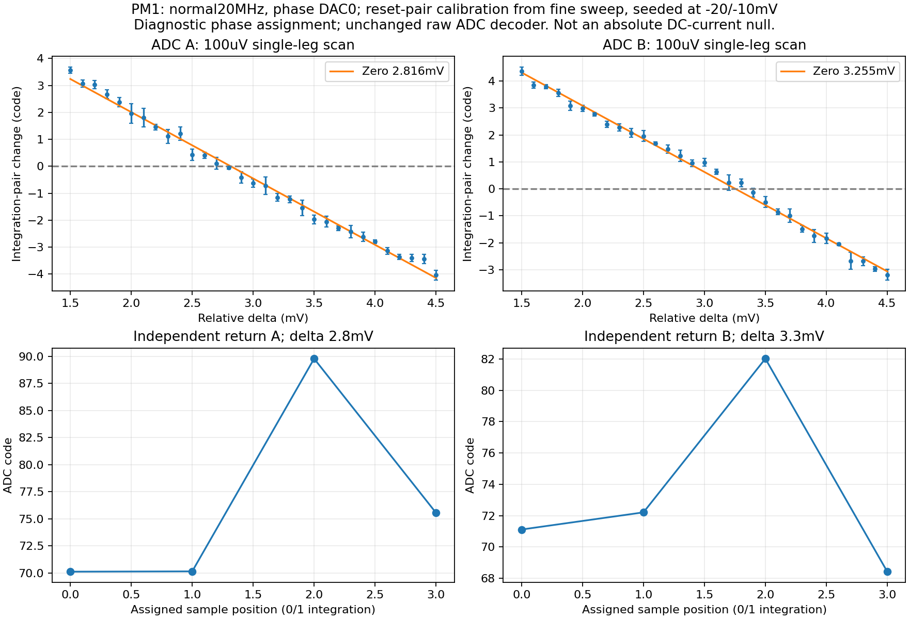

Channel1 measurement — 2026-11-18

Board PM12-K7-3A17A1B402212223, MCU1803. Both USB inputs verified on physical1.

ADC A/B transfer and all12 bits /11 adjacent pairs PASS, selected in the existing campaign under its unchanged protocol. The first full acquisition had different auxiliary DAC23 parking and was correctly refused registration; it remains in the archive. The repeated scan uses the exact earlier-series parking. Parking changes the observed ADC offset; its physical cause is not established.

Both integrators PASS_FUNCTIONAL at nominal20MHz using phase code0, a100µV single-leg scan and reset-reference cyclic alignment. A: delta2.8mV, DAC2=1.0268V; B: delta3.3mV, DAC2=1.0273V; DAC3=2.048V. Two independent returns per bank are within2ADC codes; ±5mV controls have opposite signs. This is sampled-pair balance, not a calibrated DC-current null. It is a separate diagnostic method, not retroactive acceptance under the older sealed integrator protocol.

The initial automatic run at phase32768 was incomplete. Phase probing, coarse/fine captures, initial rejected validation and corrected reset-model calibration are retained. The final model/source were frozen before a fresh independent validation. No fine or final validation buffer was rejected. Six clipped coarse+20mV buffers are excluded explicitly.

No CPLD/FPGA/MCU programming or PLL profile changes. No SMU access or production PDF generation. Final phase0, DAC01=1/1V, DAC23=1.024/2.048V; fitted1–4 amps/bypass/monitors inhibited, I2C muxes0; Kasli HDMI outputs retained.

Raw-data archive includes failed and superseded attempts, native source snapshots, buffers and logs. Every archived file was read back and checked against raw-manifest.json.

