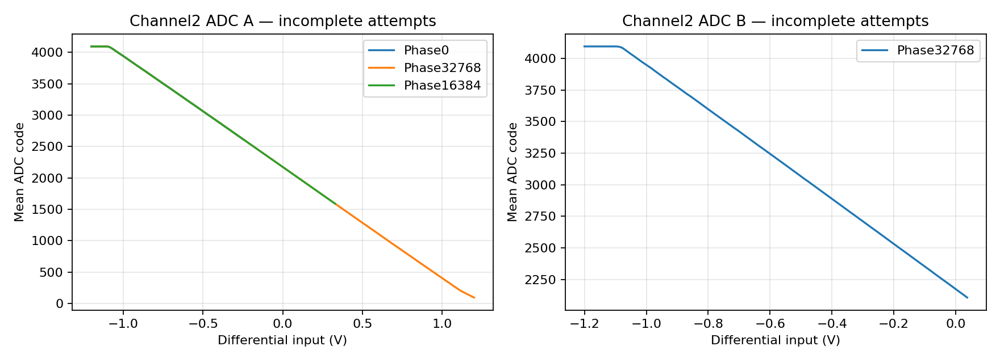

# Channel2 ADC — 18 November2026 — INCOMPLETE

Board PM12-K7-3A17A1B402212223, MCU1803; CFD03 on physical PM2. Fresh FPGA DNA/MCU/IPbus identity bound to batch ch01-04-attempt003. Both USB declared moved to2; active/inhibited probes verify DAC01→J8 on2. DAC23/J6 was not exercised this turn.

ADC reacts normally to the differential stimulus: active slopes approximately−1777/−1789code/V versus inhibited+6.7/+3.7code/V. Full257-level/bank scans cannot be qualified: unchanged two-sample stability validation stopped all three attempts. Phase0:103completed buffers, next A buffer3unstable positions (D2). Phase32768:390completed buffers (full A), next B buffer4unstable positions (D6). Phase16384:164completed buffers, next A buffer3unstable positions (D6). These are XOR differences between consecutive selected samples, not proof of a short or identified hardware cause.

No unstable samples were removed, no partial scans merged, no decoder thresholds changed, no failed run marked PASS. No full bit/adjacent-pair acceptance or ADC2 campaign selection was made. Raw failed buffers and all successful partial captures are preserved. Plots show partial mean response only. Phase0/32768/16384 are separately labelled; timing margin remains unresolved.

Previous channel2 integrator diagnostics remain unchanged. No CPLD/FPGA/MCU programming, PLL profile change, SMU/TDC repeat or production PDF generation. Final phase0, DAC01=1/1V,23=1.024/2.048V; fitted1–4 amps/bypass/monitors inhibited, muxes0, Kasli outputs retained. All archive files were read back and SHA256 verified.

