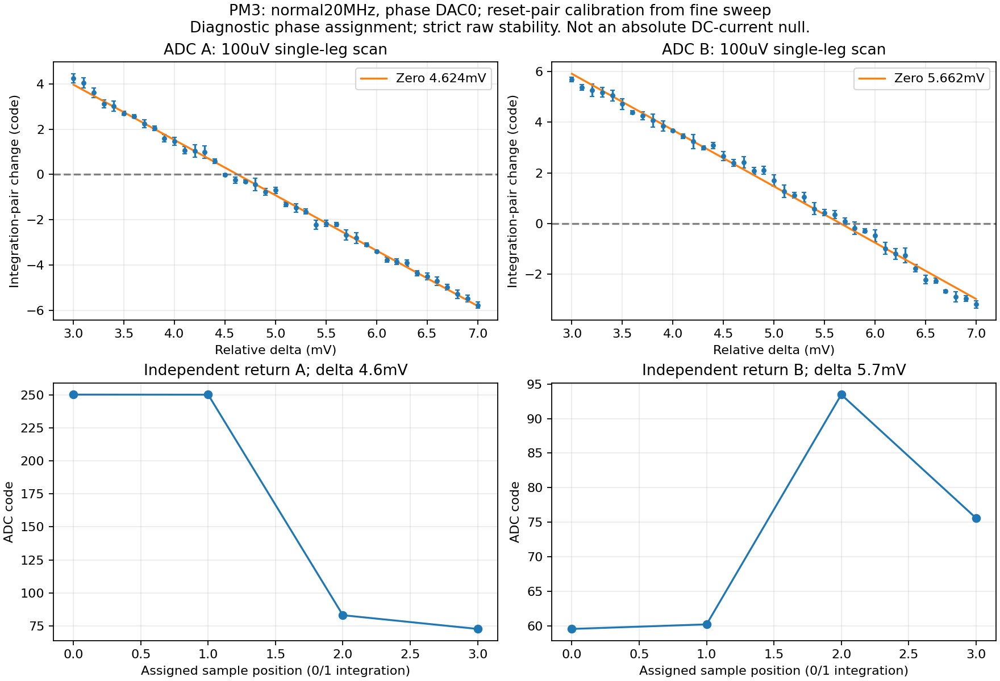

# PM3 integrator repeat — 19 November2026

Board PM12-K7-3A17A1B402212223, MCU1803, resident FPGAff2f746c, fitted CFDs1–4; CFD02 on PM3. Owner moved DAC to3; both USB inferred from preceding instruction. This acquisition independently verifies DAC23/J6 on3 by signed response; DAC01/J8 was not exercised, previous ADC3 qualification retained.

Integrator A/B PASS_FUNCTIONAL with nominal20MHz gates, legacy before-str raw decoding and phaseDAC0. Initial str-rise/32768 attempt failed disabled-control data stability before any stimulus points; retained. Phase probe then found all30enabled baseline buffers coherent under legacy policy across five phase codes; restored0. Complete coarse40/fine328/validation64 transfer buffers were coherent under the selected phase0 policy. Fine and validation buffers unclipped; four coarse B/+20mV buffers clipped and excluded explicitly.

Fine P-only41points,3..7mV at100µV command steps with DAC3fixed2.048V. A candidate delta4.6mV: DAC2=1.0286V; independent returns−0.000073/−0.141code. B delta5.7mV: DAC2=1.0297V; returns+0.316/+0.064code. ±5mV responses A+11.87/−12.10code, B+11.18/−12.36code. All satisfy abs(return)<=2codes and opposite signs beyond±4codes. Fits A−2438.88/B−2220.34code/V. These are independently selected per-bank balance points, not one simultaneous A/B null or calibrated current null.

Generalized reset-reference analysis seeds only an unambiguous positive integration pair above both reset samples under−20mV stimulus, matches−10mV reset reference, calibrates reset levels using fine sweep alone and checks independent validation afterward. This handles PM3 A's large integration/reset DC separation without incorrectly selecting the reset-release jump as integration. Same RMS<=5code and separation>=3code guards retained. Exact model/source frozen before independent validation. Replay on PM1 reproduces prior fit and validation values exactly. Integration raw decoder window is explicit in scan metadata and analysis; historical defaults unchanged.

This is separate diagnostic functional evidence, not retroactive selection under the older sealed integrator campaign contract. No source or raw evidence from earlier attempts altered. No CPLD/FPGA/MCU programming, PLL profile change, SMU/TDC/ADC-transfer repeat or production PDF generation. Final phase0, DAC01=1/1V,23=1.024/2.048V; all fitted1–4 amps/bypass/monitors inhibited, TCA0; Kasli outputs retained. Archive read-back SHA256 verified.

