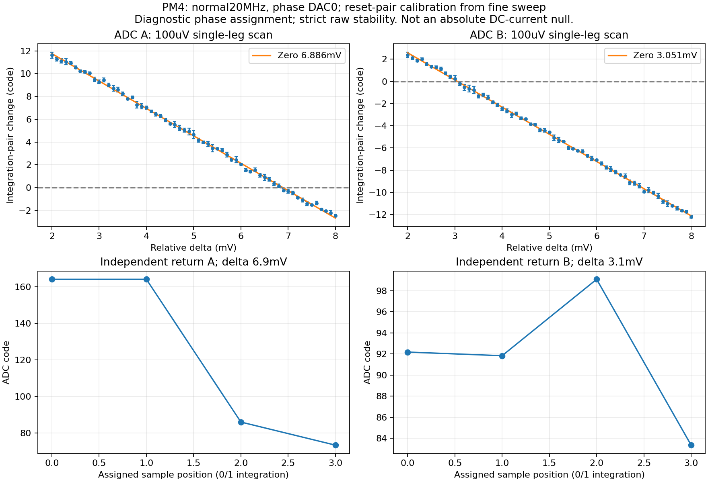

# PM4 integrator repeat — 19 November2026

DUT PM12-K7-3A17A1B402212223, MCU1803, FPGAff2f746c; fitted CFDs1–4, CFD01 on PM4. Owner moved cables to4. DAC23/J6 on4 verified independently by signed integrator response; DAC01/J8 not exercised, existing ADC4 results retained.

Both integrators PASS_FUNCTIONAL at nominal20MHz, phaseDAC0, legacy before-str raw window. Coarse40, fine488 and independent validation64 transfer buffers coherent; no rejected or clipped buffers. Fine61points from2to8mV in100µV steps on DAC2, DAC3fixed2.048V. Model/source frozen before validation. Same reset-reference method/guards as PM3; no analysis changes.

| Bank | Selected delta | DAC2 / DAC3 | Independent returns(code) | Change at−5/+5mV(code) |
|---|---:|---|---|---|
| A |6.9mV|1.0309 /2.0480V|+0.192 /+0.303|+12.59 /−11.41|
| B |3.1mV|1.0271 /2.0480V|−0.167 /−0.162|+11.65 /−12.42|

Fits A−2406.78/B−2446.77code/V. Per-bank sampled-pair balance, not simultaneous A/B null or calibrated DC-current null. Separate diagnostic evidence; no retroactive selection into the older sealed integrator campaign contract.

No CPLD/FPGA/MCU programming, PLL profile change, ADC transfer/TDC/SMU repeat or production PDF generation. Final phase0, DAC01=1/1V,23=1.024/2.048V; fitted1–4 amps/bypass/monitors inhibited, TCA0; Kasli outputs retained. Archive read-back SHA256 verified. Integrator6 remains unresolved and needs a fitted simulator/cable move.

