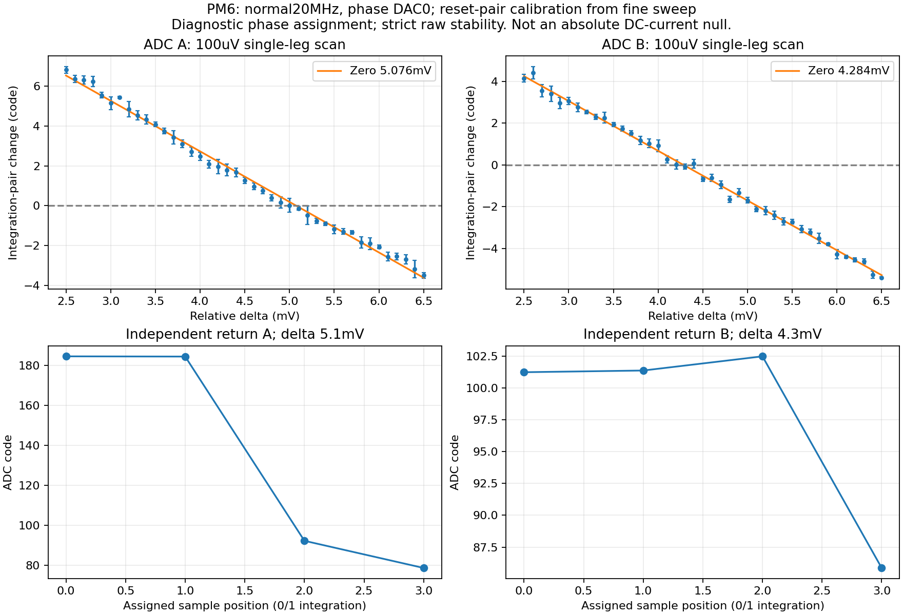

# PM6 integrator repeat — 19 November2026

Owner correction: CFD simulators fitted on3,4,5,6; USB on6. Moved simulator identities and RJ45 mapping not verified in this analog test. DAC23/J6→physical6 independently confirmed by signed response; DAC01/J8 not exercised. Existing ADC6 evidence retained.

Initial PM Ethernet unavailable; Kasli bridge operational, MCU1803/PGOOD/PRIMARY PLL healthy but console FPGA not ready. JTAG DNA verified3A17A1B402212223, USERCODEffffffff. Exact known ff2f746c SRAM image restored, SHA25628fb5747bafe575455bff8bf91484c8ebb5303ea18d3e0a0925fdb0c4283d0b2. IPbus identity restored. No FPGA Flash, MCU, CPLD or PLL profile programming. Generated payload.hex and JTAG extraction workspace excluded from archive; hash, loader and full logs retained.

After moving modules, an inhibit readback failed because relevant expander pins were still inputs. Cleanup now sets inhibit latches before making only GPA7/GPA3/GPB5 outputs, preserving other directions. All fitted3–6 inhibit readbacks verified. Initial coarse acquisition before explicit phase confirmation retained separately; definitive coarse repeated after acknowledged phase0.

Both integrators PASS_FUNCTIONAL at nominal20MHz, phase0/before-str raw window. Full coarse40buffers, focused fine328 and independent validation64 coherent, unclipped and unambiguous. Earlier wide fine488buffers was raw-coherent but reset-reference registration became ambiguous at larger positive bankB offsets. No thresholds changed: that wide analysis failure and buffers retained. Preliminary unambiguous low-range data localized roots; new focused41-point2.5..6.5mV scan at100µV steps performed before separate validation. Model/source frozen before returns; no final analysis rejections.

| Bank | Selected delta | DAC2 / DAC3 | Independent returns(code) | Change at−5/+5mV(code) |
|---|---:|---|---|---|
| A |5.1mV|1.0291 /2.0480V|−0.283 /−0.482|+12.31 /−11.91|
| B |4.3mV|1.0283 /2.0480V|−0.245 /+0.171|+11.61 /−12.65|

Fits A−2535.07/B−2384.00code/V. Per-bank sampled-pair balance, not simultaneous A/B null or calibrated current null. This separate diagnostic functional method does not retroactively alter the old sealed integrator campaign selections. Earlier channel6 ambiguity was not labelled a repaired physical fault; no soldering/component change is established here.

Final phase0, DAC01=1/1V,23=1.024/2.048V; all fitted3–6 amps/bypass/monitors inhibited, TCA0, Kasli outputs retained. Final cleanup PASS. No SMU/TDC/ADC-transfer repeat or production PDF generation. Archive files read-back SHA256 verified.

Previously unresolved integrators3/4/6 now each have separate successful functional fine-scan/return evidence. Whole-board production release still needs the evidence/coverage audit described in the active workflow.

